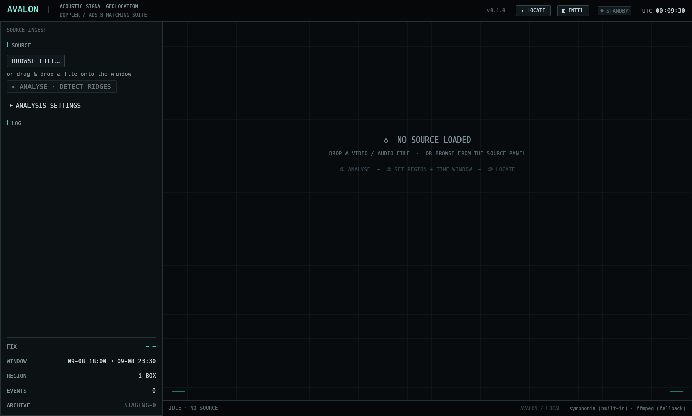
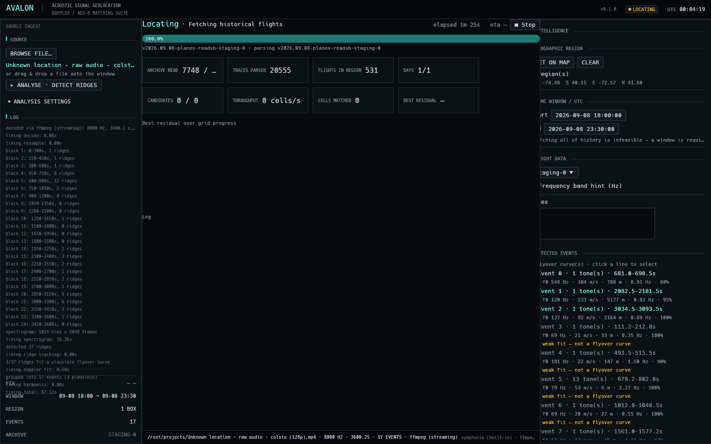

# Avalon

Ultimate OSINT for **video/audio sources** — geolocate a recording from the
acoustic Doppler signature of aircraft (and, later, lightning and other
tell-tale signals) it captured.

Dark, QGIS-inspired GUI. Rust. Built around a faithful reimplementation of the
[DOPPLERGEIST](https://github.com/1337isnot1337/DOPPLERGEIST) aircraft-Doppler
method.

Reference case (colsto's Oyster Bay clip, 2026-09-08): **40.8817, -73.5204 —
0.7 km from the true receiver**, pair `a1dfeb + ace391`, residual 1.53 Hz, with
the entire top eight candidate cells inside 810 m. Search settings are
`AOS_METHOD=legacy` to fall back to the earlier squared-error backend.

## Interface

Tactical instrument-panel surface: monospaced throughout, hairline borders, a single
signal-cyan accent with amber/red reserved for state, and a persistent instrument strip
(mission line, state pill, UTC clock) with a live readout column (fix, window, region,
events, archive).

| Standby | Locating |
|---|---|
|  |  |

## What this version does

1. **Ingest** a source video or audio file (OS native file dialog, or drag-and-drop).
2. **Optional intelligence** — supply anything you already know to narrow the work:
   - geographic region (draw one or more rectangles on an OSM slippy map)
   - recording time window (UTC, mandatory for search — calendar picker)
   - frequency band of interest, notes
3. **Analyze & parameterize** the audio: decode → mono PCM → resample →
   time-whitened spectral-contrast spectrogram → **Viterbi ridge tracking**
   (slope/curvature bounded, soft-masked, model-extended) → per-ridge robust
   **Doppler fit** with a physical plausibility gate → **harmonic grouping**.
4. **Geolocate** — pick detected events, set region + time window, and
   **Process**: fetch historical flights (ADSB.lol archives) that cross the
   region in that window, score every candidate receiver location against the
   observed Doppler curve (retarded-time trajectory model), and render a
   **heatmap** of likely origin.
   The locate stage is a live dashboard of *measured* values: archive bytes read
   vs the release's stated size, traces parsed, flights kept, days done,
   candidate throughput, best residual with its coordinate and ICAO, a sparkline
   of the running best, and the log — plus a Stop button that aborts the
   download.
5. Visualize the spectrogram with ridges + fitted curves, and export a JSON report.

Lightning-strike and other signal modalities come next.

## Build & run

Requirements: Rust (2024 edition) and — optionally — `ffmpeg`/`ffprobe` on `PATH`.

```bash
cargo run --release
```

Decoding is **symphonia-first** (pure Rust, zero system deps; handles WAV, MP3,
FLAC, OGG, AAC, ALAC, AIFF, CAF, and MP4/MKV containers). If symphonia cannot
open a container/codec, the app falls back to a bundled or PATH-resolved
`ffmpeg`. To ship a self-contained build, drop `ffmpeg` and `ffprobe` binaries
into `resources/bin/` (or next to the executable); the app locates them there
automatically.

## Architecture

```
src/
  main.rs            entry point, window setup
  app.rs             egui UI: panels, spectrogram plot, event browser
  theme.rs           dark QGIS-like theme
  filebrowser.rs     built-in file picker (no native-dialog dependency)
  model.rs           shared types (Metadata, Ridge, DetectedEvent, DopplerFit, ...)
  pipeline.rs        orchestration + progress reporting + JSON export
  decode.rs          symphonia + ffmpeg decoding backends
  dsp/
    spectrogram.rs   STFT + per-bin spectral contrast
    ridge.rs         peak extraction + bounded-slope ridge linking
    harmonics.rs     rational-ratio harmonic grouping
    doppler.rs       constant-velocity Doppler fit (Nelder-Mead)
```

The scientific method is documented in [`docs/METHOD.md`](docs/METHOD.md).

## Method provenance

The physics and pipeline are an independent Rust reimplementation of the
approach demonstrated by [Colsto](https://www.youtube.com/watch?v=UytYrhYLOKI)
and independently implemented by DOPPLERGEIST. Doppler geometry and the
detection front-end are mathematics/DSP, not copyrightable expression; this
project contains original code and is not affiliated with either project.

DOPPLERGEIST itself is distributed under the
[PolyForm Noncommercial 1.0.0](https://polyformproject.org/licenses/noncommercial/1.0.0/)
license. If you reuse any of its code, data, or artifacts, you must honor that
license (noncommercial use only, absent separate authorization).
